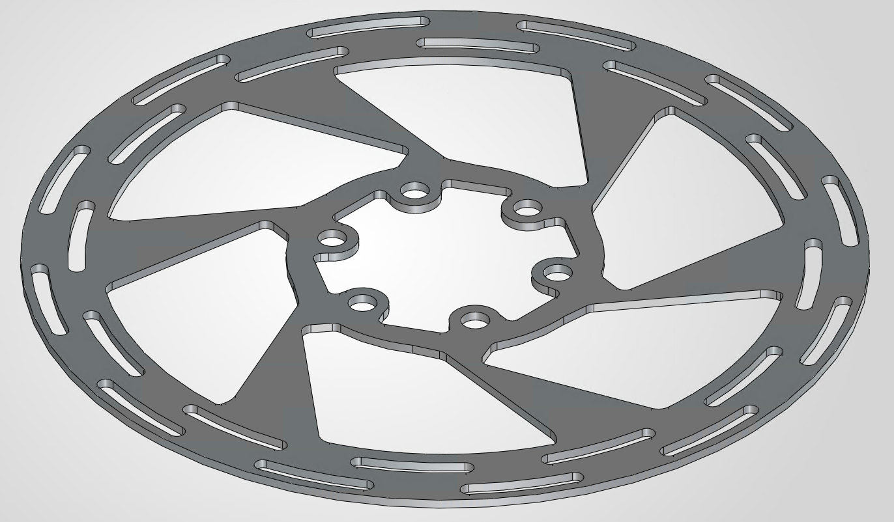

# Bicycle Disc-Brake Rotor Optimisation

**Cameron Jones | Independent engineering project | Work in progress**

An ongoing investigation into reducing the mass of a road-bike disc-brake rotor while retaining acceptable thermal and structural performance. The study combines analytical braking-load calculations, SOLIDWORKS CAD and planned finite-element analysis (FEA).

**[Download the latest successfully built draft report (PDF)](https://github.com/cameronojones/bicycle-disc-brake-rotor-optimisation/releases/download/latest-report/Brake_Rotor_Report.pdf)**

The PDF link becomes available after the first successful automated build. It represents the latest successful GitHub build; changes still in Overleaf are included after they are pushed to GitHub. The report contains unfinished sections and marked TODOs.

## Engineering question

Can a representative road-bike rotor geometry be modified to reduce mass without unacceptable increases in temperature, stress or deformation under realistic braking conditions?

The commercial reference is a **160 mm SRAM Paceline six-bolt rotor**. This is an independent design study using a simplified reconstruction, with unpublished dimensions estimated from a scaled product image.

## Progress

| Area | Current status |
| --- | --- |
| Operating conditions | Recorded Richmond Park and Surrey Hills riding conditions documented |
| Analytical model | Emergency-braking and sustained-descent load cases calculated |
| Baseline CAD | Simplified rotor model completed in SOLIDWORKS |
| Material assumptions | Representative AISI 410 properties documented; actual commercial alloy is unconfirmed |
| Numerical analysis | Thermal and structural boundary conditions, FEA and mesh verification remain to be completed |
| Design development | Alternative geometries and quantitative comparison remain to be completed |
| Final results | No validated mass-reduction or FEA performance results claimed at this stage |

## Current model inputs

These are analytical load estimates and baseline CAD properties, rather than measured rotor performance or completed simulation results.

| Quantity | Current value |
| --- | --- |
| Combined rider and bicycle mass | 84 kg |
| Baseline CAD rotor mass | 125.47 g |
| Structural design torque | 110 N m |
| Front-rotor energy input for sustained descent | 17.9 kJ |
| Sustained-descent duration | 196 s |
| Equivalent mean rotor heat input | 91.4 W |

The emergency-braking torque and sustained-descent thermal input describe separate load cases. The report documents assumptions including braking distribution, aerodynamic and rolling resistance, and representative material properties.

## Baseline geometry



## Repository contents

- [`main.tex`](main.tex): working LaTeX report, including calculations, assumptions and planned analysis.
- [`references.bib`](references.bib): bibliography used by the report.
- [`Figures/`](Figures/): baseline CAD illustrations included in the report.
- [`.github/workflows/build-report.yml`](.github/workflows/build-report.yml): automatic compilation and PDF publication.

The current source includes CAD illustrations; native SOLIDWORKS models and FEA files are not included in this version.

## Next steps

1. Define and implement thermal and structural boundary conditions.
2. Check mesh sensitivity and establish baseline numerical results.
3. Develop and compare alternative rotor geometries.
4. Evaluate mass, peak temperature, stress and deformation together.
5. Document the final design choice and modelling limitations.

The present scope is analytical and numerical. Manufacture and experimental testing are outside the current project scope.

## Report updates and reproduction

The LaTeX source is maintained in Overleaf. After changes are pushed from Overleaf to the repository's default branch, GitHub Actions compiles `main.tex` with pdfLaTeX/latexmk and BibTeX in a full TeX Live environment, then updates the PDF linked above. A failed compilation does not publish a new PDF; check the Actions tab for build status.

For a local TeX Live installation with the required packages:

```sh
latexmk -pdf -file-line-error -halt-on-error -interaction=nonstopmode main.tex
```

For current source files, use **Code → Download ZIP** on the repository's default branch. A ZIP uploaded as an ordinary file is a fixed snapshot. The rolling PDF release's automatically generated source archives refer to its original tag; use the repository download for current source.

## Scope and limitations

The geometry and material model are simplified representations. The project does not establish that any proposed rotor is suitable for manufacture or road use. Future conclusions will depend on the stated assumptions and numerical verification; physical validation is outside the current scope.
